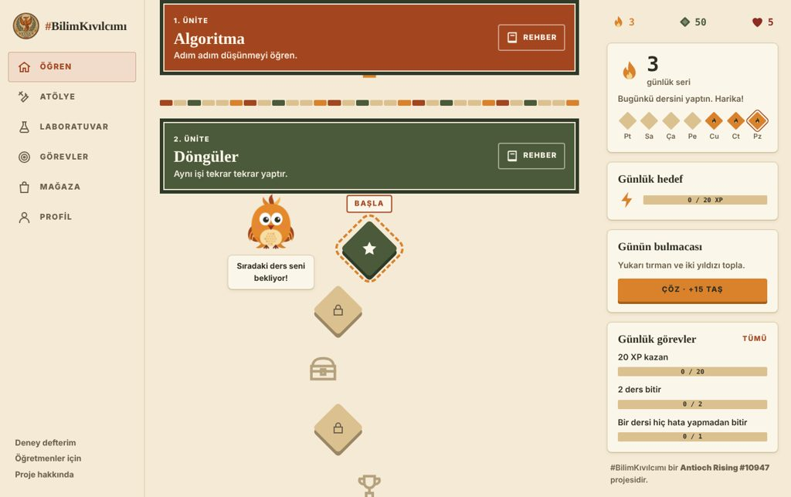
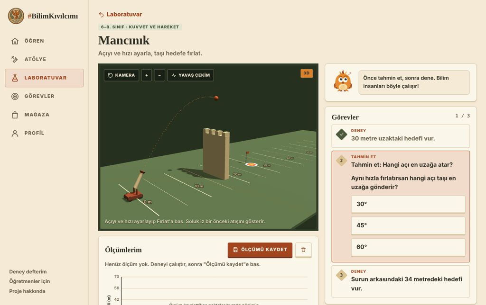

# #BilimKıvılcımı

**Hatay'daki çocuklar için ücretsiz bilim ve kodlama sitesi.** Bir [Antioch Rising #10947](https://github.com/alideniztartma) projesi.

Öğrenciler maskotumuz **Anka** ile oyun oynar gibi kodlama öğrenir, 3 boyutlu laboratuvarda deney yapar, ölçümlerini deney defterine kaydeder. Öğretmenler hazır ders planlarını ve yazdırılabilir etkinlik kâğıtlarını kullanır, sınıflarının ilerlemesini takip eder.



## Anka ile tanışın

Anka, Antioch Rising'in yavru anka kuşudur. Anka kuşu küllerinden yeniden doğar. Hatay da depremden sonra yeniden ayağa kalkıyor. Anka da çocuklara her hatadan sonra yeniden denemeyi öğretir. Göğsündeki mozaikler Antakya'nın ünlü mozaiklerinden gelir.

Anka sitenin her yerindedir: dersleri anlatır, doğru cevapta sevinir, yanlış cevapta cesaret verir, ders yolunda sıradaki dersi gösterir, laboratuvarda ipucu verir. Mağazadan ona zeytin dalı, bilge gözlüğü, mühendis bareti ve taç alınabilir.

Duolingo'daki Duo gibi canlıdır: nefes alır, göz kırpar, etrafına bakar, kuyruğunu sallar. Doğru cevapta zıplar, üst üste doğrularda takla atar ve döner, yanlışta başını sallayıp üzülür, ders bitince dans eder. Dokununca da rastgele bir hareket yapıp konuşur.

## Neler var?

### Kodlama yolu ("Yazılımın Duolingosu")
- 5 ünite, 16 ders: algoritma, döngüler, koşullar, değişkenler, fonksiyonlar
- 7 çeşit alıştırma: seçmeli soru, boşluk doldurma, blok dizme, eşleştirme, cevabı yazma, hatalı satırı bulma, robot yönetme
- XP, günlük seri, kalpler, mozaik taşları, sandıklar, kupalar, rozetler ve ünite sertifikaları
- Karışık tekrar, hatalarımı çalış, hız turu, ünite sınavı ve günün robot bulmacası
- Çizim atölyesi (kaplumbağa grafiği), kodlama sözlüğü, sesli okuma
- Günlük görevler ve mağaza

### 3 boyutlu laboratuvar


| Deney | Sınıf | Konu |
|---|---|---|
| Sarkaç | 6–8 | Salınım süresi, yer çekimi (Dünya, Ay, Mars, Jüpiter) |
| Kaldıraç | 8 | Basit makineler, kütle × uzaklık |
| Elektrik devresi | 4–7 | Seri ve paralel bağlama, anahtar, sökülen lamba |
| Kesirler | 3–6 | Denk kesirler, çubuk ve pasta modeli |
| Mancınık (yeni) | 6–8 | Eğik atış, açı ve hız, sur duvarı |
| Yüzer mi, batar mı? (yeni) | 6 | Yoğunluk, tatlı su, tuzlu su, zeytinyağı |
| Ay'ın evreleri (yeni) | 5 | Güneş, Dünya ve Ay, Dünya'dan görünüş |
| Işık ve aynalar (yeni) | 7 | Yansıma kanunu, 3 bölümlük bulmaca |

Her deneyde:
- 3 görev: önce **tahmin et**, sonra **dene ve kontrol et**
- Canlı ölçüm göstergeleri, kamera kontrolü, yavaş çekim
- **Ölçümü kaydet** ile tablo ve grafik (formül eğrisiyle karşılaştırma)
- "Bu nasıl çalışıyor?": formül, açıklama, gerçek hayattan örnek, ilginç bilgi
- Görev başına +10 XP ve +5 mozaik taşı, laboratuvar rozetleri

**Deney defterim** sayfası bütün ölçümleri tablo ve grafik olarak toplar, yazdırılabilir.

### Alanlar: Yazılım, Mekanik, Elektronik
Öğrenci ilk açılışta hangi alanı öğrenmek istediğini seçer. Sonra üst çubuktaki küçük alan düğmesiyle (Duolingo'daki dil bayrağı gibi) istediği zaman geçebilir. Her alan, kodlama yolundaki gibi ünitelerden, derslerden, sandıklardan ve kupa sınavından oluşan bir yol haritasıdır. Yolun sonunda sıradaki üniteler "Yakında" olarak görünür.

| Alan | Üniteler |
|---|---|
| Yazılım | Algoritma · Döngüler · Koşullar · Değişkenler · İlk Python kodum · Robot yazılımı |
| Mekanik | Basit makineler ve dişliler (2 ders) |
| Elektronik | Elektrik devreleri (2 ders) |

Yeni ünite eklemek için `js/egitim.js` dosyasında `U.push(...)` ile `field` alanı verilmiş bir ünite ekleyin; "Yakında" listesi aynı dosyadaki `FIELDS` içindedir.

### Yönetici istatistik paneli (canlı)
`#yonetici` adresinde (menüde **Yönetici paneli**). Toplam kayıtlı kullanıcı, son 7 ve 30 günde aktif kullanıcı, yeni kayıtlar, ders bazında tamamlama sayıları, alan ve deney bazında kullanım, son 14 günün günlük aktif öğrenci grafiği ve öğrenci listesi. Veriler her dakika kendiliğinden yenilenir.

**Nasıl çalışır:** Öğrenci ders bitirdikçe site ilerlemesini [Supabase](https://supabase.com) veritabanına gönderir. Gönderilen veri **adsızdır**: rastgele bir kimlik, ders ve deney sayıları, etkinlik günleri. Her cihaz yalnızca kendi kaydını, cihazda saklanan gizli bir anahtarla güncelleyebilir; kayıtları yalnızca yönetici hesapları okuyabilir. İnternet yoksa site bekler, bağlantı gelince gönderir. Öğrenci isterse **Profil › Ayarlar › Anonim istatistik** ile gönderimi kapatabilir.

**Kurulum (bir kez):**
1. Supabase panelinde **SQL Editor › New query** açın, [`supabase/kurulum.sql`](supabase/kurulum.sql) dosyasının tamamını yapıştırıp **Run**'a basın.
2. **Authentication › Users › Add user › Create new user** ile yönetici hesabını oluşturun (e-posta ve şifre, **Auto Confirm User** işaretli). Yönetici e-postaları `kurulum.sql` içindeki `bk_admins` listesindedir.
3. İsteğe bağlı: ücretsiz projeler bir hafta etkinlik olmazsa duraklatılır. [`supabase/supabase-uyanik.yml`](supabase/supabase-uyanik.yml) dosyasını `.github/workflows/` klasörüne taşırsanız GitHub üç günde bir veritabanını yoklar.

İnternete hiç bağlanmayan sınıflar için panelin **Kodla veri ekle** bölümü öğrenci kodlarını ve öğretmen sınıf dosyalarını da okur; bunlar canlı verilerle birleştirilir.

### Öğretmenler için
- 9 hazır ders planı (8 deney + robot kodlama), her biri 40 dakikalık akışla
- Siyah beyaz basılabilen A4 etkinlik kâğıtları
- Sınıf takibi: öğrenciler profillerindeki ilerleme kodunu öğretmene gönderir, öğretmen kodları yapıştırıp ders, deney görevi ve XP tablosunu görür. Hiçbir veri sunucuya gönderilmez.

## Kullanma

**İnternetten:** GitHub Pages ile yayınlanır. Depo ayarlarında *Settings › Pages › Deploy from a branch › main / (root)* seçmek yeterlidir.

**İnternetsiz:** *Code › Download ZIP* ile klasörü indirip USB belleğe kopyalayın. Sınıftaki bilgisayarda `index.html` dosyasına çift tıklayın. Kurulum gerekmez.

Bütün ilerleme tarayıcının `localStorage` alanında, yalnızca o cihazda saklanır. Hesap açmak ya da kişisel bilgi vermek gerekmez.

## Dosyalar

```
index.html        Uygulamanın kabuğu
lab.html          Eski bağlantılar için yönlendirme
css/style.css     Mozaik tasarım sistemi (açık ve koyu tema)
js/icons.js       Yardımcılar, simgeler, kod renklendirme
js/anka.js        Anka maskotu (SVG, ruh halleri, aksesuarlar)
js/data.js        Dersler, bulmacalar, sözlük, mağaza, görevler
js/core.js        Durum, ses, bildirim, ödüller
js/sync.js        Otomatik, adsız istatistik gönderimi (Supabase)
js/learn.js       Kodlama yolu, alıştırmalar, atölye, profil
js/lab.js         3 boyutlu deneyler, görevler, deney defteri
js/egitim.js      Alanlar (Yazılım, Mekanik, Elektronik) ve yeni üniteler
js/teacher.js     Öğretmen sayfası ve proje hakkında
js/admin.js       Yönetici istatistik paneli
js/main.js        Sayfa yönetimi ve başlatma
js/three.min.js   three.js r149 (MIT lisansı)
```

Derleme adımı yoktur. Dosyaları düzenleyip tarayıcıyı yenilemek yeterlidir.

## Engineering Inspiration

#BilimKıvılcımı, depremden sonra laboratuvarı ve kursu olmayan okullara ücretsiz bir bilim laboratuvarı götürmek için yapıldı. Ücretsiz, Türkçe, açık kaynak ve internetsiz çalışır. Öğretmenlerle birlikte okullara götürülür, sınıf takibiyle etkisi ölçülür.

## Lisans

MIT. Ayrıntılar için [LICENSE](LICENSE) dosyasına bakın. three.js kendi MIT lisansıyla dağıtılır.
